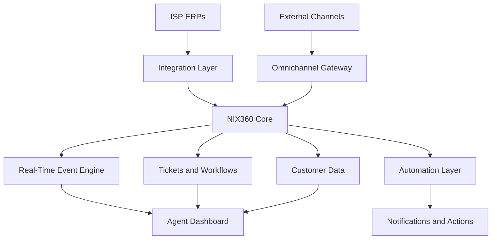

 
<div align="center">


<a href="https://github.com/WITHE24">
  
</a>

<br/>


</div>

---

## `> whoami`

```typescript
interface SoftwareArchitect {
  identity: string;
  brand: string;
  mission: string;
  mindset: string[];
  specializations: string[];
}

const andres: SoftwareArchitect = {
  identity: "Andrés | ENMANUEL",
  brand: "KRIONIXTECH",

  mission:
    "Transform complex systems into powerful digital experiences.",

  mindset: [
    "Think in systems",
    "Build for scale",
    "Design with purpose",
    "Automate everything possible",
    "Never compromise user experience"
  ],

  specializations: [
    "Fullstack Engineering",
    "Omnichannel Architecture",
    "Real-Time Communication",
    "ISP Ecosystems",
    "Enterprise Integrations",
    "UX/UI Engineering"
  ]
};
```

> **I don't just build applications. I engineer ecosystems.**

Soy desarrollador fullstack enfocado en construir **software empresarial, plataformas omnicanal y arquitecturas escalables**, combinando ingeniería backend, interfaces de alto rendimiento y automatización inteligente.

Mi especialidad consiste en conectar sistemas complejos, transformar información fragmentada en operaciones centralizadas y desarrollar productos que puedan crecer sin comprometer su arquitectura.

Actualmente impulso el desarrollo de soluciones tecnológicas dentro del ecosistema **KRIONIXTECH**, con especial atención a plataformas SaaS, operaciones ISP y comunicación en tiempo real.

---

## `01 // ENGINEERING DNA`

<div align="center">

| ESPECIALIDAD | ENFOQUE |
|:---|:---|
| 🏗️ **Software Architecture** | Sistemas modulares, mantenibles y escalables |
| 🌐 **Omnichannel Engineering** | Comunicación unificada, tickets y agentes |
| ⚡ **Real-Time Systems** | WebSockets, eventos y sincronización |
| 📡 **ISP Ecosystems** | Mikrowisp, Krill y operaciones de proveedores |
| 🔌 **Enterprise Integration** | APIs, ERPs, automatizaciones y servicios |
| 🎨 **UX/UI Engineering** | Interfaces premium, rendimiento y accesibilidad |
| 🛡️ **Secure Development** | Validación, autorización y protección de datos |
| ☁️ **Infrastructure** | Contenedores, despliegues y optimización |

</div>

---

## `02 // TECHNOLOGY ARSENAL`

<div align="center">

### CORE LANGUAGES


### FRONTEND ENGINEERING


### BACKEND & APIs


### DEVOPS & INFRASTRUCTURE


### DESIGN & DEVELOPMENT TOOLS


<br/>


</div>

---

## `03 // FEATURED ECOSYSTEM`

<div align="center">

### ⚡ NIX360 — OMNICHANNEL PLATFORM

**Unified communications. Intelligent workflows. Scalable operations.**


</div>

**NIX360** es una plataforma enfocada en centralizar comunicaciones, datos y operaciones empresariales en una experiencia unificada.

El proyecto combina gestión omnicanal, eventos en tiempo real, automatización e integración con sistemas externos.

### System Architecture



### Engineering Focus

- **Omnichannel Inbox:** gestión centralizada de conversaciones y agentes.
- **Real-Time Events:** sincronización de estados mediante WebSockets.
- **Ticket Lifecycle:** seguimiento operativo de incidencias y solicitudes.
- **ISP Integration:** conexión de información comercial y técnica.
- **Performance Engineering:** virtualización de listas y optimización del renderizado.
- **Automation:** reducción de tareas repetitivas y orquestación de flujos.

---

## `04 // ISP SOFTWARE ENGINEERING`

<div align="center">

### 📡 CONNECTING NETWORK OPERATIONS WITH MODERN SOFTWARE

`ISP → ERP → INTEGRATION → API → REALTIME → EXPERIENCE`

</div>

Construyo soluciones orientadas a transformar los procesos operativos de proveedores de servicios de Internet.

```text
╔══════════════════════════════════════════╗
║           ISP DIGITAL ECOSYSTEM           ║
╠══════════════════════════════════════════╣
║                                          ║
║  CUSTOMER MANAGEMENT                     ║
║  BILLING & PAYMENTS                      ║
║  TECHNICIAN OPERATIONS                   ║
║  SUPPORT TICKETS                         ║
║  SERVICE MANAGEMENT                      ║
║  NOTIFICATIONS                           ║
║  ERP INTEGRATION                         ║
║  REAL-TIME MONITORING                    ║
║  WORKFLOW AUTOMATION                     ║
║                                          ║
╚══════════════════════════════════════════╝
```

**Principio de ingeniería:** los sistemas empresariales no deben funcionar como islas. Cada integración debe reducir fricción, mejorar la trazabilidad y facilitar la operación.

---

## `05 // DEVELOPMENT PHILOSOPHY`

```text
                    KRIONIXTECH
                         │
            ┌────────────┴────────────┐
            │                         │
       ENGINEERING                EXPERIENCE
            │                         │
       Architecture                 UX/UI
       Performance                  Clarity
       Security                     Accessibility
       Scalability                  Interactions
            │                         │
            └────────────┬────────────┘
                         │
                  DIGITAL PRODUCTS
                         │
                BUILT FOR THE FUTURE
```

Mi forma de desarrollar software se apoya en cuatro principios:

**01. Architecture Before Complexity**

Una arquitectura debe facilitar la evolución del producto, no convertirse en un obstáculo.

**02. Performance Is a Feature**

La velocidad, la estabilidad y la eficiencia forman parte de la experiencia del usuario.

**03. Design Is Engineering**

Una interfaz bien diseñada reduce errores, acelera flujos de trabajo y mejora la productividad.

**04. Automation Creates Leverage**

El software debe eliminar procesos innecesarios y permitir que las personas se concentren en decisiones importantes.

---

## `06 // GITHUB ANALYTICS`

<div align="center">


<br/>


### CONTRIBUTION ACTIVITY


</div>

---

## `07 // CURRENT MISSION`

```diff
+ Building NIX360 Omnichannel
+ Designing scalable ISP solutions
+ Improving real-time architectures
+ Engineering premium user experiences
+ Integrating enterprise ecosystems
+ Exploring intelligent automation

! Always shipping.
! Always improving.
! Always engineering.
```

### On the Radar

**Engineering:** arquitecturas modulares, optimización de estados complejos y sistemas orientados a eventos.

**Product:** herramientas operativas para empresas, ISPs y plataformas omnicanal.

**Innovation:** automatización inteligente, análisis de datos y asistentes aplicados a flujos empresariales.

---

## `08 // LET'S CONNECT`

<div align="center">

### HAVE A COMPLEX PROBLEM? LET'S ENGINEER A SOLUTION.

Me interesa colaborar en proyectos de ingeniería de software, SaaS, omnicanalidad, sistemas ISP y automatización empresarial.

<a href="https://github.com/WITHE24">
  
</a>

<br/><br/>

**KRIONIXTECH**

*Building the infrastructure behind better digital experiences.*

</div>

---

<div align="center">


**© KRIONIXTECH — Engineered with purpose.**

</div>
